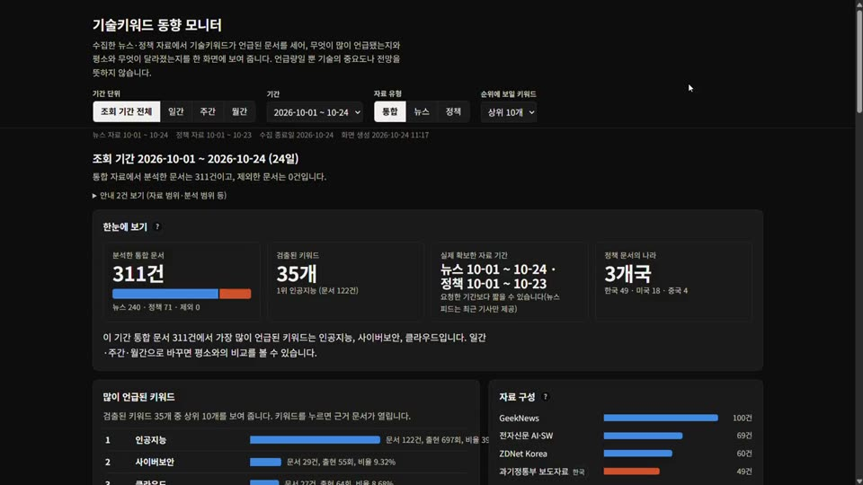

# 뉴스·정책 기술키워드 모니터

> **배포 주소(GitHub Pages, 합성 샘플 데모)**
> - 소유자(hyeon0): https://hyeon0.github.io/policy-tech-trend-monitor/
> - 팀원(daehyun5oh, fork 배포): https://daehyun5oh.github.io/policy-tech-trend-monitor/
>
> **수업일(2026-10-17) 마지막 병합 이후 바뀐 것**: [비교 링크](https://github.com/hyeon0/policy-tech-trend-monitor/compare/3965f54059d32a17cbb2d843dc188f0063b8e86f...main)


뉴스와 정부 발표를 모아, **어떤 기술 용어가 몇 건의 글에서 언급됐는지** 기간별로 세어 줍니다.

| | |
|---|---|
| **넣는 것** | 뉴스 4곳, 정책 6곳의 공개 자료 |
| **하는 일** | 글을 모아 정리하고, 기술 용어를 찾아 세기 |
| **받는 것** | 화면(대시보드), 주간·월간 보고서, 표 파일(CSV) |

직접 명령을 실행해서 쓰는 도구입니다. 서버에 올라가 있지 않습니다.

> **먼저 알아두세요.** 여기서 나오는 숫자는 **"얼마나 많이 언급됐는가"**입니다.
> 그 기술이 더 중요하다거나 앞으로 유망하다는 뜻이 아닙니다.

---

## 소개 영상 (3분 54초)

[](https://hyeon0.github.io/policy-tech-trend-monitor/media/intro.mp4)

**[▶ 영상 보기](https://hyeon0.github.io/policy-tech-trend-monitor/media/intro.mp4)** · [GitHub에서 열기](docs/media/intro.mp4)

이 도구를 왜 만들었는지, 어떻게 쓰는지, 디지털·ICT 관심 주제에 어떻게 쓸 수 있는지, 고친 부분과 써 보니 아쉬운 점을 직접 녹음해 설명합니다. 영상 속 화면은 직접 수집한 자료로 만든 대시보드이며, 공개 가능한 범위의 제목과 집계값만 보입니다.

## 데모로 먼저 보기

- 샘플 데이터로 만든 데모 대시보드: [`docs/index.html`](docs/index.html) (GitHub Pages로 공개하면 `https://<사용자>.github.io/policy-tech-trend-monitor/`). 제목·출처·숫자는 모두 지어낸 합성 자료이며 `python src/build_demo.py`로 다시 만듭니다.
- 화면 사용 가이드(화면 구성·읽는 법·시연 순서 제안): [docs/dashboard_guide.md](docs/dashboard_guide.md)
- 공개 전 점검 기록: [docs/public_release_check.md](docs/public_release_check.md)

## 5분 따라 하기 (인터넷 없이 됩니다)

Python 3.10 이상만 있으면 됩니다. 저장소를 내려받은 폴더에서 차례로 실행하세요.

```bash
python -m venv .venv
.venv\Scripts\activate
python -m unittest discover -s tests
python src/pipeline.py --sample --with-report
```

세 번째 줄은 "코드가 멀쩡한지" 확인하는 것이고(`OK`가 나오면 성공), 네 번째 줄이 **수집부터 보고서까지 한 번에** 돌립니다. 연습용 샘플이라 인터넷도, 추가 설치도 필요 없습니다.

화면으로 보려면 한 줄 더 실행하세요.

```bash
python dashboard/app.py --dir data/processed --out data/processed/dashboard.html --open
```

**윈도우에서 `python`이 안 먹히면**: 설정 → 앱 → 앱 실행 별칭에서 `python.exe`를 끄거나 `py`를 쓰세요.
**글자가 깨지면**: PowerShell에서 `$env:PYTHONIOENCODING="utf-8"`를 먼저 입력하세요.

## 무엇이 만들어지나

| 생긴 것 | 무엇인지 |
|---|---|
| `data/processed/dashboard.html` | **화면.** 브라우저로 엽니다. 맨 위에서 기간(일·주·월)과 자료 유형(뉴스·정책·전체)을 고르면, 한 화면에 위에서 아래로 한눈에 보기 → 많이 언급된 키워드 → 평소와 달라진 키워드 → 뉴스와 정책의 차이 → 분야 안에서 보기 → 최근 흐름이 나옵니다. 키워드를 누르면 그 숫자가 **어느 글에서 나왔는지** 보여 줍니다. 각 차트에는 ‘표로 보기’가 있고, 읽는 법은 화면 안에 적혀 있습니다 |
| `reports/` | **보고서.** 주간·월간 문서입니다. 그대로 공유하거나 보고에 쓸 수 있습니다 |
| `data/processed/documents.csv` | 모은 글 목록. 한 줄이 글 하나입니다 |
| `data/processed/document_keywords.csv` | 어떤 글에서 어떤 용어가 나왔는지 |
| `data/processed/keyword_stats.csv` | 기간별로 센 결과(순위·글의 수·비율). 화면의 순위와 보고서는 **이 파일을 똑같이 읽습니다** |

필드 하나하나의 뜻은 [데이터 사전](docs/data_dictionary.md)에 있습니다.

## 실제 자료로 돌리기

### 가장 쉬운 방법: 기간을 입력해서 보기

```bash
python setup_env.py     # 처음 한 번 (정책 수집용 패키지 설치. 뉴스만 볼 때는 생략 가능)
python monitor.py       # 시작일·종료일을 물어봅니다. 그냥 Enter 면 최근 7일
```

입력한 기간의 뉴스·정책을 모아 대시보드를 브라우저로 엽니다. `python monitor.py --from 2026-10-14 --to 2026-10-21`처럼 바로 줄 수도 있습니다.

- 받은 자료는 **컴퓨터의 임시 폴더**에 쌓이고, 실행할 때마다 발행일이 90일보다 오래된 자료가 지워집니다(`--keep-days`로 변경, `--fresh`로 실행 전 비우기, `--clean`으로 즉시 삭제). 저장소의 `data/`는 건드리지 않습니다.
- **뉴스 피드는 최근 기사만 줍니다**(ZDNet 약 15시간, 긱뉴스 약 하루, 전자신문 약 이틀, 보안뉴스 약 4주). 그래서 먼 과거를 입력해도 뉴스는 비어 있을 수 있고, 실행이 끝나면 **요청한 기간과 실제로 받은 기간**을 나란히 알려 줍니다. 며칠 간격으로 다시 실행하면 받는 기간이 늘어납니다.
- 정책 수집은 패키지가 필요합니다. 설치하지 않았다면 정책만 건너뛰고 안내가 나옵니다.
- 만들어진 대시보드에는 제목과 링크가 들어 있으니 다른 사람에게 보내지 마세요.

### 매일 자동으로 모으고 싶다면

저장소의 `data/`에 계속 쌓으면서 쓰려면(정기 수집과 함께) 두 줄이면 됩니다.

```bash
python setup_env.py          # 처음 한 번: 가상환경(.venv)을 만들고 정책 수집기용 패키지를 설치
python src/run_daily.py      # 뉴스·정책 수집 → 키워드 추출 → 집계 → 검증 → 대시보드 갱신
```

- 결과는 **내 컴퓨터**의 `data/processed/dashboard.html`에만 생깁니다. 서버가 없고, 수집한 자료도 저장소에 올라가지 않습니다.
- `setup_env.py`를 건너뛰어도 됩니다. 그러면 정책 수집만 빠지고(안내 문구가 나옵니다) 뉴스 수집부터 대시보드까지는 그대로 돕니다. 정책 수집이 가능한지는 `python setup_env.py --check`로 봅니다.
- 뉴스만 하고 싶으면 `python src/run_daily.py --no-policy`.
- 정책 수집은 하루 한 번만 합니다(그날 이미 했으면 건너뜁니다). 매번 하려면 `--policy-every-run`.
- **수집한 자료를 담은 대시보드 파일과 CSV는 다른 사람에게 보내지 마세요.** 기사 제목과 링크가 들어 있어 재배포가 됩니다.

아래는 단계를 하나씩 직접 돌리고 싶을 때의 명령입니다.

```bash
pip install -r requirements.txt          # 정책 수집에만 필요합니다
python src/collect_news.py rss --from 2026-10-01 --to 2026-10-31
python src/collect_policy.py --from 2026-10-01 --to 2026-10-31
python src/extract_keywords.py
python src/aggregate.py
python src/generate_report.py --period-type weekly
```

처음에는 조금만 받아 보세요. 실제로 요청을 보내지 않고 대상만 확인할 수도 있습니다.

```bash
python src/collect_policy.py --dry-run
python src/collect_policy.py --source-id policy-kr-001 --limit 10
```

### 어디서 모으나

이용 조건을 확인한 곳만 모읍니다. 확인 기록은 [출처 정책](docs/source_policy.md)에 있습니다.

| 출처 | 공개할 수 있는 범위 |
|---|---|
| 과기정통부 보도자료 (한국) | 자료마다 공공누리 유형을 확인 |
| 백악관 OSTP · NSF · DOE (미국) | 본문 글자만. 사진·로고는 받지 않음 |
| 국무원 · 중국과학원 (중국) | **제목·본문 공개 불가.** 분석은 하되 공개물에는 주소·날짜만 |
| 긱뉴스 · 전자신문 · ZDNet · 보안뉴스 (한국) | 제목·주소·날짜와 집계값만 |

수집 기간은 뉴스와 정책 모두 **2026-05-01 ~ 2026-10-31**로 맞췄습니다.

### 알아 두면 좋은 것

- 뉴스 피드는 **최근 글만** 줍니다. 그래서 실행할 때마다 받은 것을 쌓아 둡니다. 며칠 모아야 추이가 보입니다
- 뉴스는 `python src/run_daily.py` 하나로 수집부터 화면 갱신까지 돌릴 수 있습니다. 매일 자동으로 돌리는 방법은 바로 아래 「자동으로 돌리기」에 있습니다
- 수집에 실패해도 **다시 시도하지 않습니다.** 어디서 왜 실패했는지 기록만 남깁니다
- 받은 원문은 내 컴퓨터에만 두고 저장소에 올리지 않습니다

### 자동으로 돌리기 (Windows, 처음 한 번)

뉴스 피드는 최근 글만 주기 때문에, 매일 두 번 자동으로 받아 쌓아야 추이가 보입니다. PowerShell에서 저장소 폴더 기준으로 아래를 한 번 실행하면 매일 09:00·21:00에 `run_daily.py`가 돕니다. `main`을 체크아웃한 상태로 두고, 노트북이면 전원을 꽂아 두세요.

```powershell
$repo = (Get-Location).Path
$py   = (Get-Command pythonw).Source
$act  = New-ScheduledTaskAction -Execute $py -Argument "src/run_daily.py" -WorkingDirectory $repo
$trg  = @((New-ScheduledTaskTrigger -Daily -At 09:00), (New-ScheduledTaskTrigger -Daily -At 21:00))
$set  = New-ScheduledTaskSettingsSet -StartWhenAvailable -RunOnlyIfNetworkAvailable -WakeToRun -MultipleInstances IgnoreNew -ExecutionTimeLimit (New-TimeSpan -Minutes 30)
Register-ScheduledTask -TaskName PolicyTechTrendMonitor-Collect -Action $act -Trigger $trg -Settings $set
```

실행 여부는 `Get-ScheduledTask -TaskName PolicyTechTrendMonitor-Collect | Get-ScheduledTaskInfo` 와 `data/logs/` 로 확인합니다. PC가 꺼져 있거나 절전 중이면 그 시각에는 돌지 않습니다(절전 중 깨우는 설정, 삭제 방법, 한계는 [자동 실행 안내](docs/automation.md)). `setup_env.py`로 패키지를 설치해 두었다면 정책 수집도 함께 돕니다.

## 꼭 알아둘 한계

직접 돌려 보고 확인한 것만 적었습니다.

| 한계 | 무슨 뜻인가 |
|---|---|
| **언급 ≠ 주제** | 낱말이 한 번만 나와도 1건으로 셉니다. 전기차 기사에 "AI 음성 기능"이 한 번 나오면 인공지능 1건이 됩니다 |
| **비슷한 말을 못 가립니다** | 날씨 기사의 `cloud`(구름)를 클라우드로, 옛날 게임 이름 `DX`를 디지털 전환으로 센 적이 있습니다 |
| **사전에 없으면 못 찾습니다** | `robotic`, `해킹` 같은 표기가 사전에 없어 관련 글을 놓쳤습니다 |
| **출처마다 글 길이가 다릅니다** | 본문 길이 중간값이 과기정통부 98자, 백악관 OSTP 8,056자입니다. **출처끼리 숫자를 그대로 비교하면 안 됩니다** |
| **옛날 자료를 다 못 받는 곳이 있습니다** | NSF·DOE는 최신 글만 보여 줍니다. 꾸준히 돌려서 쌓아야 합니다 |
| **정확도를 재지 않았습니다** | 품질 검토는 사례를 모은 기록입니다. "정확도 몇 %" 같은 말은 하지 않습니다 |

사례와 근거는 [정책 자료 검토](docs/policy_quality_review.md), [뉴스 자료 검토](docs/news_quality_review.md), [교차 검토](docs/news_cross_review.md)에 있습니다.

**아직 없는 기능**: ICT와 무관한 기사를 걸러내는 규칙, 자동 알림. 전체 범위는 [기획안](기획안.md)에 있습니다.

## 잘 안 될 때

| 이런 일이 생기면 | 이렇게 해 보세요 |
|---|---|
| 글자가 깨져 보임 | `PYTHONIOENCODING=utf-8`를 먼저 지정하세요 |
| `수집 실패 (fetch_error)` | 인터넷 연결을 확인하고 직접 다시 실행하세요. 자동으로 다시 시도하지 않습니다 |
| 검증에서 오류가 나옴 | 오류에 적힌 파일·줄 번호를 [데이터 사전](docs/data_dictionary.md)과 맞춰 보세요 |
| 날짜가 없는 글이 빠짐 | 일부러 그렇습니다. 수집한 날로 대신 채우지 않습니다 |
| 결과가 비어 있음 | 그 기간에 모은 글이 없다는 뜻입니다. 기간을 넓혀 보세요 |
| 스캔한 PDF | 글자를 읽을 수 없어 건너뜁니다 |
| API 키 누락 | `.env` 파일이 있는지, 이름이 `.env.example`과 같은지 보세요 |

## 숫자를 어떻게 세는지

- 미리 만든 **기술용어 사전**과 글자를 맞춰 봅니다. 같은 뜻의 다른 표기는 하나로 모읍니다 ([규칙](docs/extraction_rules.md), [사전](docs/dictionary_v1.md))
- 주 지표는 **그 용어가 나온 글의 수**입니다. 몇 번 나왔는지는 보조로만 씁니다
- 기간은 한국 시각 기준으로 하루·월요일부터 일요일·달력 한 달입니다 ([기간 규칙](docs/period_policy.md))
- 화면의 순위·글의 수와 보고서는 **같은 집계 파일**을 읽어 숫자가 같습니다. 다만 ‘평소와 달라진 키워드’, ‘뉴스와 정책의 차이’, ‘분야 안에서 보기’의 비교 값(‘뚜렷함/참고용’ 포함)은 화면이 문서 목록에서 직접 계산합니다. 정의는 [화면 설명](docs/insight_views.md)에 있습니다

## 자료를 다룰 때 지키는 것

- 이용 조건을 확인하기 전에는 모으지 않습니다
- 로그인·유료 벽을 **우회하지 않습니다**. 제공자가 닫아 둔 경로를 다른 방법으로 뚫지 않습니다
- **볼 수 있다고 다시 배포해도 되는 것은 아닙니다.** 원문은 내 컴퓨터에만 두고, 공개 저장소에는 집계값과 샘플만 둡니다
- 담당자 이름·연락처 같은 개인정보는 모으지 않습니다
- 비밀값은 `.env`에만 둡니다

자세한 기준은 [출처 정책](docs/source_policy.md)에 있습니다.

## 믿을 만한가

- 테스트: `python -m unittest discover -s tests` (인터넷 없이 돌고, 정답은 사람이 손으로 계산해 넣었습니다)
- 무엇을 어떻게 확인했는지: [검증 기록](docs/validation.md)
- 시연 순서와 실제 출력: [시연 대본](docs/demo_rehearsal.md)

<details>
<summary>테스트 파일별로 무엇을 확인하는지 (펼치기)</summary>

| 파일 | 확인하는 것 |
|---|---|
| `test_collect_news.py` | 뉴스 수집·누적·제외 사유 |
| `test_extract_keywords.py`, `test_fixture_consistency.py` | 키워드 추출이 정답과 맞는지, 두 번 돌려도 같은지 |
| `test_normalize.py` | 주소 정리, 중복 제거, 빠진 값 |
| `test_aggregate.py` | 세는 방식과 순위를 손으로 계산한 정답과 대조 |
| `test_generate_report.py` | 보고서 숫자가 집계 파일과 같은지, 제한 출처 제목이 가려지는지 |
| `test_pipeline.py` | 처음부터 끝까지 한 번에 도는지, 실패를 기록하는지 |
| `test_dashboard.py` | 화면 숫자가 집계 파일과 같은지 |
| `test_validate_csv.py`, `test_stdlib_only.py` | 파일 형식, 외부 패키지 사용 범위 |

</details>

## 더 보기

| 궁금한 것 | 문서 |
|---|---|
| 이 프로젝트가 무엇을 어디까지 하려는지 | [기획안](기획안.md) |
| 파일 형식과 필드 뜻 | [데이터 사전](docs/data_dictionary.md) |
| 출처별 이용 조건 | [출처 정책](docs/source_policy.md) |
| 키워드를 찾는 규칙 | [추출 규칙](docs/extraction_rules.md) |
| 화면의 각 보기가 무슨 뜻인지 | [화면 설명](docs/insight_views.md) |
| 설치·환경 문제 | [환경 안내](docs/environment.md) |
| 함께 작업하는 규칙 | [CLAUDE.md](CLAUDE.md) |

## 라이선스

코드와 문서는 [MIT 라이선스](LICENSE)입니다. **수집한 기사·정책 자료는 이 저장소에 포함되어 있지 않으며** 라이선스 대상도 아닙니다. 자료를 수집할 때는 각 출처의 이용 조건을 직접 확인하고 따라야 합니다(`docs/source_policy.md`, `config/sources.csv`).
